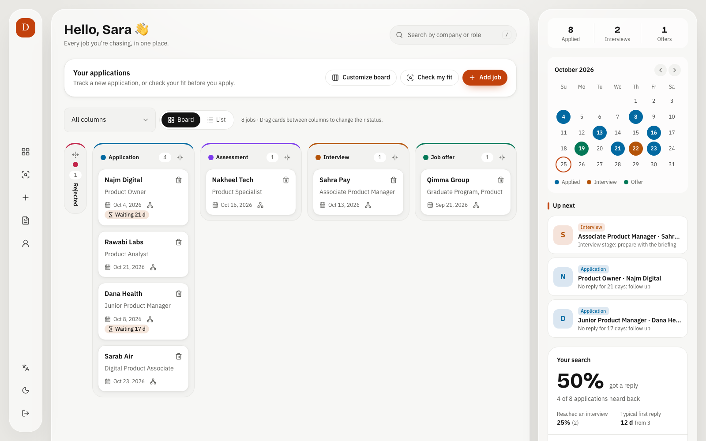
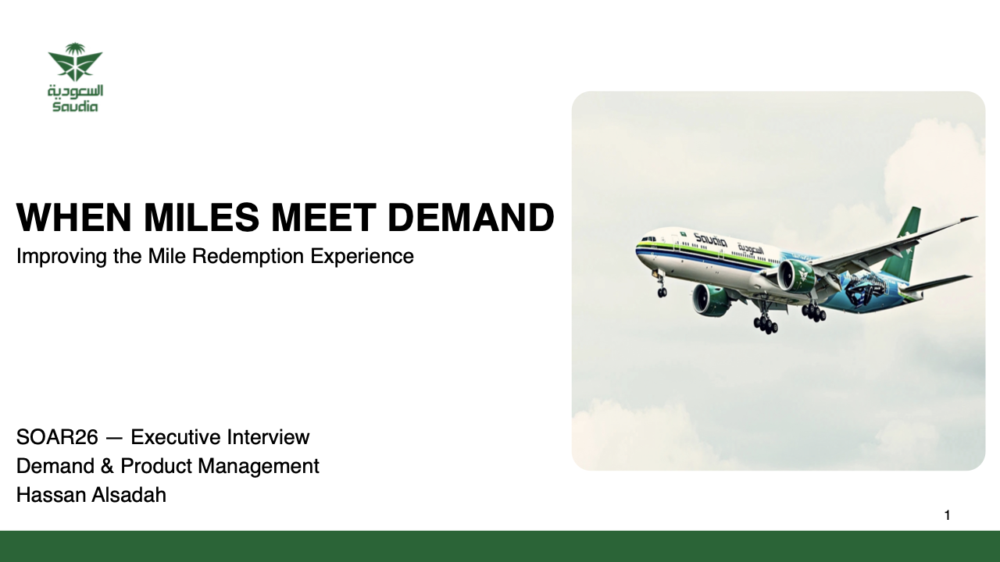
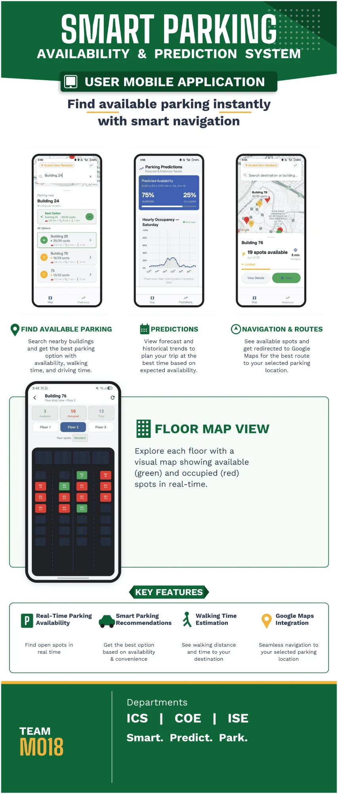
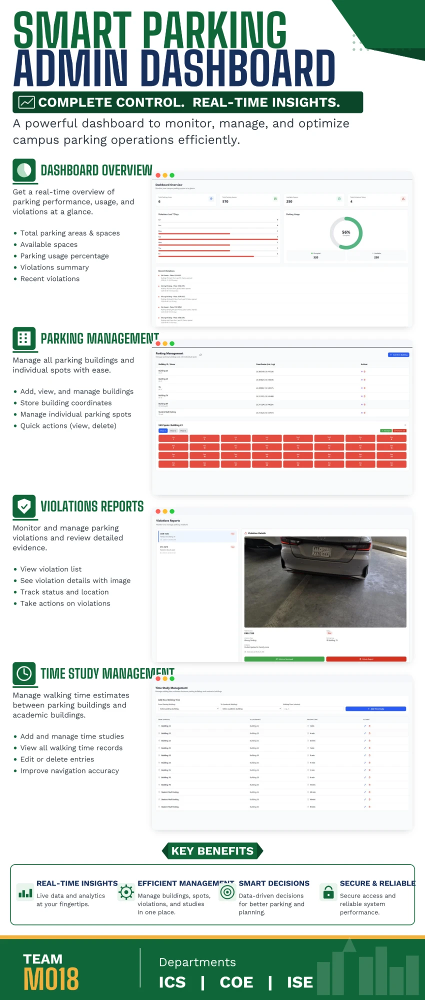

  

  

  
  
  

<b>Open to Product Manager and Product Owner roles · Saudi Arabia</b>

---

### About me

I'm a software engineer focused on cloud computing and product-driven development, based in Saudi Arabia.
I'm PSPO I and CAPM certified, with strong foundations in Agile and the SDLC.
I like translating user needs into technical products and working in collaborative, cross-functional teams.

---

### Experience

**Software Engineering Intern, Halliburton** · Singapore · Jun–Aug 2025
- Gathered requirements and designed UI mockups in Figma for petroleum engineering applications.
- Built a Python GUI (PySide6) that streamlines WIM/CAST modeling workflows for engineering analysis.
- Built a machine learning model (KNN, SVM, Random Forest) that classifies 4 types of downhole leaks from acoustic data.

---

### Projects

Each project follows the same format: **Problem → What I did → Outcome**.

 

#### 1. Dreamplish: from the dream to the offer

  
  
  
  

- **Problem:** job seekers track applications in scattered places and spend hours researching each company before interviews.
- **What I did:** owned the product end to end: discovery, competitor analysis, PRD, MoSCoW/RICE prioritization, roadmap and metrics, then built and shipped it using AI-assisted development, while making every product decision myself.
- **Outcome:** live and free to use: one place that tracks every application and helps you win it, in Arabic and English.

<b>See all 16 features</b>

- **Kanban board:** drag jobs between stages, add and rename your own columns (names translate between Arabic and English), or switch to a list view.
- **Status timeline:** every step of each application with dates, plus the next step to take.
- **Insights panel:** reply rate, follow-ups due and where your applications stand.
- **Check my fit:** paste a job or its link and get a requirement-by-requirement match score *before* you apply; unsent checks stay as drafts.
- **Job description from a link:** fetches the description from the company's careers page.
- **Match & CV score:** how well your CV fits each job, with the skills you're missing.
- **Tailored CV:** rewritten for the job using only facts from your CV, in the design of the CV you matched, ready to save as PDF.
- **CV builder:** upload a PDF or Word CV and it's split into editable sections (no AI); keep up to 10 versions, choose layout, colour, font and spacing with a live preview, and download as PDF. With several CVs you pick which one each match uses.
- **Dashboard overview:** Applied / Interviews / Offers, an activity calendar, and what's up next (interviews to prepare for, follow-ups due).
- **Company briefing:** news, products, values, in-demand skills, Saudi salary ranges and watch-outs, with a source for every fact.
- **Interview prep:** likely questions and talking points from the job, your CV and the briefing.
- **Outlook sync:** reads your inbox (read-only) and suggests status updates you approve.
- **Where you applied:** track the channel (company site, LinkedIn, referral and more) for each job.
- **Usage limits:** your remaining daily AI and sync usage, shown on your profile.
- **Privacy built in:** Google sign-in, your data visible only to you, undo on delete, and one-click account deletion.
- **Arabic and English:** full right-to-left layout, plus light and dark mode.

 

#### 2. When miles meet demand: improving Saudia's Alfursan mile redemption

  
  
  

- **Problem:** Alfursan members with many miles struggle to find reward flights that fit their plans, which erodes their confidence that miles turn into real travel.
- **What I did:** mapped the redemption journey, reviewed public customer feedback and mapped four stakeholders around one trade-off: more redemptions without hurting fare revenue. Found that in the SAUDIA app cash fares follow demand but mile prices don't: the same miles were worth 0.105 SAR per mile on a low-demand day and 0.143 SAR on a high-demand day, up to 35% apart.
- **Outcome:** proposed dynamic reward pricing, where flight demand sets the miles required, with a pilot on 2–3 high-volume routes measured by redemption growth, search-to-booking conversion and CSAT.

 

#### 3. Circless: real-time smart parking (senior design project)

<table>
  <tr>
    <td width="50%" align="center"> <b>User mobile app</b></td>
    <td width="50%" align="center"> <b>Admin dashboard</b></td>
  </tr>
</table>

  
  
  
  

- **Problem:** drivers need to know where parking is free right now, not after they arrive.
- **What I did:** provisioned a virtual machine and used Google Cloud Storage for data persistence; handled real-time parking status and user interactions with Firebase; integrated occupancy and violation detection into the app; added the Google Maps API for parking locations and navigation.
- **Outcome:** a cloud-based system, kept in sync between the backend and the apps, with two parts:
  - **User mobile app:** find available parking with walking and driving times, occupancy predictions from forecasts and historical trends, Google Maps navigation, and a live floor map of free (green) and occupied (red) spots.
  - **Admin dashboard:** real-time usage overview, building and spot management, violation reports with photo evidence, and walking-time studies between parking and academic buildings.

---

### Skills

**Technologies**

  

Plus: SQL · RESTful APIs · Software architecture 

**Soft skills**
Problem-solving and analytical thinking · Stakeholder communication · Cross-functional collaboration · Adaptability and continuous learning

---

### Education and certifications

| | |
|---|---|
| **B.Sc. Software Engineering** | King Fahd University of Petroleum and Minerals (KFUPM), 2021–2026 · Concentration in Cloud Computing |
| **PSPO I** | Professional Scrum Product Owner, Scrum.org, 2026 |
| **CAPM** | Certified Associate in Project Management, PMI, 2025 |
| **Digital Product Management Training** | Olo Academy, 40 hours, 2025 |

---

  <picture>
    <source media="(prefers-color-scheme: dark)" srcset="https://raw.githubusercontent.com/HassanAlsadah/HassanAlsadah/output/snake-dark.svg" />
    
  </picture>

  

